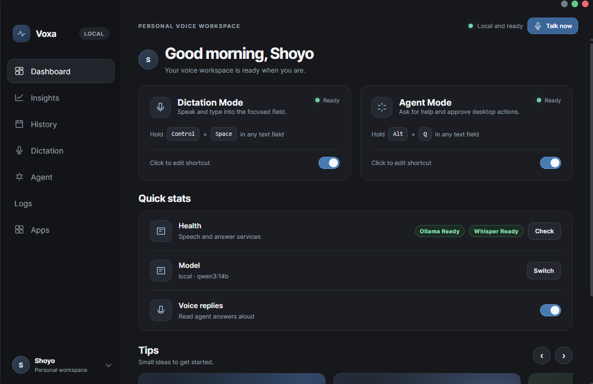
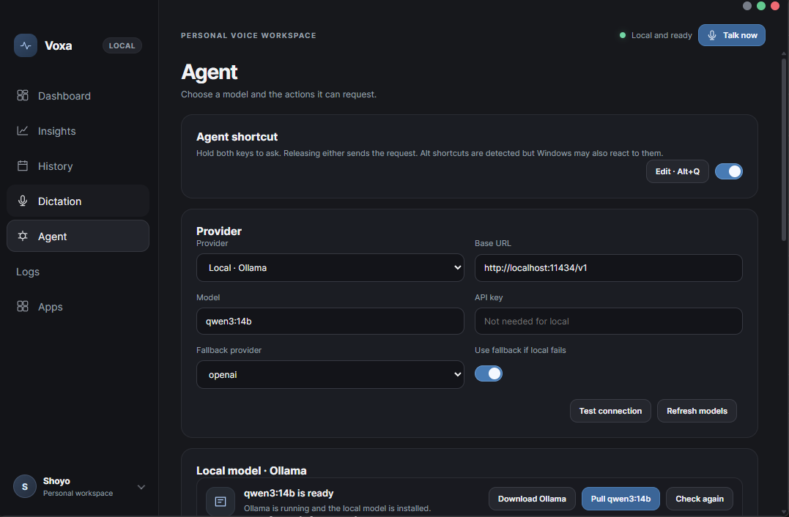

# Voxa

Voxa is a local-first Windows voice assistant with two push-to-talk modes, a top-center notch, a tray menu, and a frameless dashboard. Hold a shortcut (or use **Talk now**) to record; release to transcribe. Dictation types the transcript into the app that was focused when the hold began. Agent mode answers questions and can request approved desktop actions.





## Interface

The dashboard contains Dashboard, Insights, History, Dictation, Agent, Logs, Apps, Settings, and About pages. Change either mode shortcut from its card using the press-to-record editor. The defaults are **Ctrl+Q** for Dictation and **Alt+Q** for Agent; the editor also offers **F9** and **Ctrl+Space** presets. Ctrl+Space may conflict with the Windows input-language switch, and Alt shortcuts may still reach the focused application's menu because the native hook observes keys rather than suppressing them. A hold shorter than 250 ms is ignored; recognized audio includes a 300 ms release tail. Recordings under 500 ms or with near-zero RMS are not sent to a transcription service.

The overlay tracks the display containing the pointer. By default it is a floating black **Island** pill about 10 px below the top of the work area: compact for listening, medium for status text, and expanded for streamed answers, approvals, errors, and done. Width, height, and radius morph with a spring, content crossfades, waveform bars follow live microphone level, and the window stays fixed-size and click-through outside the pill. Choose **Settings > Preferences > Overlay style > Notch** to return to the older attached shape. It is non-focusable, hides when idle, and approval requests must be allowed or denied in the pill.

Dictation settings include a microphone picker, a live input meter, and a three-second **Mic test** that records, plays back, and transcribes a sample. Capture runs in a dedicated hidden renderer with media permission scoped to Voxa and background throttling disabled. Use **Settings > Diagnostics > Test overlay** to preview the notch.

The dashboard shows local service health. Agent replies stay visible in the notch for 12 seconds and can be copied. Spoken replies use Windows `System.Speech` through PowerShell.

## Agent permissions

**Agent > Permission Mode** controls whether desktop actions prompt in the notch. The choice is saved in `settings.json` and applies to hotkey, tray, and dashboard starts.

- **Ask Every Time** prompts before each action, as before.
- **Allow Routine Actions** opens files, folders, apps, and websites, and reads files in your Home, Desktop, Documents, Downloads, Pictures, Music, and Videos folders without asking.
- **Custom** lets you enable individual routine categories.

Sensitive actions always ask: typing text or submitting forms, keyboard shortcuts, scripts and downloaded executables, deleting or overwriting files, administrator-level commands, and credentials or security settings. The same action is never prompted twice in one turn, and an identical action is not repeated after it has already run. Use **Reset saved permissions** on the Agent page to switch back to Ask Every Time.

Agent tool calls are parsed against a strict per-tool schema. Unknown tools, missing or extra arguments, and oversized arguments are rejected before approval. File actions are limited to your Home, Desktop, Documents, Downloads, Pictures, Music, and Videos folders; a file read is always approved again when its text would go to a cloud provider. URLs must be HTTPS. Voxa captures the target window when the hold starts and re-checks it before typing or sending keys, so focus changes abort the insertion instead of going to the wrong app. Agent turns stop after 180 seconds, and an unanswered approval is denied after 120 seconds.

## Install

1. Install Ollama from ollama.com, then run `ollama pull qwen3:8b` (or `qwen3:14b` if you have a strong GPU).
2. Download `Voxa-Setup-x.x.x.exe` from the Releases page and run it.
3. Windows may show an "unknown publisher" warning because the installer is not code-signed. Click More info, then Run anyway.
4. Start Voxa from the Start Menu. The first launch downloads the speech model, so wait until both health badges say Ready.

Voxa is an independent project.

## Setup

Requirements: Windows 10/11, Node.js 22.12 or newer, Python 3.11+ for building the bundled speech engine, and the Windows C++ build tools for the native hotkey module.

```powershell
py -3 -m venv whisper-server\.venv
.\whisper-server\.venv\Scripts\python.exe -m pip install -r whisper-server\requirements.txt
npm install
npm start
```

The install hook rebuilds `uiohook-napi` for the installed Electron version with `@electron/rebuild`. If the native hook cannot load, Voxa reports the error in the notch and the dashboard **Talk now** control remains available; there is no alternate global-shortcut backend.

**Start with Windows** is available from Settings and the tray menu. It launches the installed app with `--hidden`, so startup stays in the tray without opening the dashboard. A single-instance lock makes a second launch focus the existing dashboard instead of starting another copy.

### Local chat model

Install [Ollama for Windows](https://ollama.com/download/windows), then open **Agent** in Voxa. When Ollama is missing or stopped, the local model card shows step-by-step setup with a **Download Ollama** button and a one-click **Pull** button for the configured model. You can also pull it manually:

```powershell
ollama pull qwen3:8b
```

The app checks that the exact configured model tag is installed.

### Local speech recognition

Voxa ships a single-file `voxa-whisper.exe` built with PyInstaller, so users do not need Python installed. In development Voxa runs `whisper-server\server.py` from the virtual environment; a packaged build launches `resources\whisper-server\voxa-whisper.exe`. The default is `small` on CPU with int8; `large-v3` remains available in **Dictation** for higher accuracy. The server parses `--host`, `--port`, `--model`, `--device`, `--compute-type`, and `--cache-dir`, reports download and loading progress through `/health`, and runs inference off the event loop.

The selected faster-whisper model is downloaded fully on first use into `%APPDATA%\my-voice-app\whisper-models` and is reused on later runs. Voxa waits for the download and shows a live progress bar on the Dashboard and Dictation pages. You can also choose cloud transcription in **Dictation**.

Build the standalone engine directly with:

```powershell
npm run build:whisper
```

The script uses `whisper-server\.venv`, installs the pinned PyInstaller build dependency from `whisper-server\requirements-build.txt` if needed, and writes `whisper-server\dist\voxa-whisper.exe`.

## Release build

Voxa 1.0.0 is packaged with electron-builder into a per-user NSIS installer.

```powershell
npm install
npm run dist
```

`npm run dist` performs the complete release build:

1. Generates `assets\icon.ico` with `npm run build:icon`.
2. Builds the bundled Whisper server with `npm run build:whisper`.
3. Runs electron-builder and writes `dist\Voxa-Setup-1.0.0.exe`.

The installer creates a **Voxa** desktop shortcut and Start Menu entry and includes an uninstaller. The app is packaged with ASAR; `node_modules\uiohook-napi` is explicitly unpacked through `build.asarUnpack` so its native prebuild loads in the installed build. The PyInstaller output is copied to `resources\whisper-server\voxa-whisper.exe` with `extraResources`.

For a faster unpacked test build, use `npm run dist:dir`; it writes an unpacked app under `dist\win-unpacked` without creating the installer.

The first electron-builder run needs internet access to download its NSIS and signing helper components. To rebuild from scratch, delete `whisper-server\dist`, `whisper-server\build`, and `dist`, then run the commands above again.

## Hotkeys and privacy

The global listener records only whether a configured shortcut was pressed or released. It does not log ordinary keystrokes. Turn logs include recording timing, audio statistics, transcript text, model replies, tool calls, and errors.

History, memory, preferences, and activation logs are stored in Electron's user data directory (`%APPDATA%\my-voice-app`). The bundled Whisper model cache is stored in `%APPDATA%\my-voice-app\whisper-models`; Ollama keeps its models in Ollama's own data folder. Provider API keys use the operating system's secure storage when available. Local model and transcription requests stay on the machine unless a cloud provider is selected.

Dictation and `type_text` paste through the clipboard. Voxa backs up the available clipboard formats and restores them after pasting; formats that Windows refuses to copy may not survive. Text insertion is refused when the original target window is no longer focused.

## UI gallery

```powershell
npm run ui-gallery
```

The gallery uses sample turns, apps, and service statuses without requiring Ollama or Whisper. The Dashboard page includes an overlay playground with a button per state, a full sequence (appear, listening, thinking, streamed answer, approval, done, disappear), 0.25x slow motion, loop, and an Island/Notch style switch. The sidebar and user menu open every dashboard page with sample data.

## Self-test

Run from a normal Windows PowerShell after `npm install`:

```powershell
npm run selftest
```

The command writes `selftest-report.txt` and exits nonzero if any check fails. It:

1. Parses every project JavaScript file while skipping generated dependency trees.
2. Verifies required dashboard/notch markup, renderer CSP, preload invoke/send/event allowlists, and dashboard/overlay/recorder IPC role separation.
3. Tests permission modes, strict tool schemas, secret redaction, approval decisions and timeouts, agent-loop round/failure/time limits, HTTPS URL policy, UTF-16 decoding, and settings security policy.
4. Starts a separate Electron worker that checks settings and shortcut parsing, loads the native hotkey hook, enumerates microphones, verifies the exact Ollama model, starts Whisper, transcribes a Windows-generated speech sample, shows and measures the notch, opens every dashboard page, and exercises live history/log filters and renderer console errors.

The runtime worker uses the normal local user data and activation log. It does not save settings or send provider requests, but it may start/download the configured Whisper model. Ollama, a working Whisper environment, and at least one microphone must be available for the full run. The generated speech sample means no speaking is required. The suite does not simulate a physical microphone hold or a complete model-chosen desktop action; those still require a manual voice test. Use the static-only pass to skip Electron and service checks:

```powershell
node selftest.cjs --static-only
```

Static-only runs also write `selftest-report.txt`.
